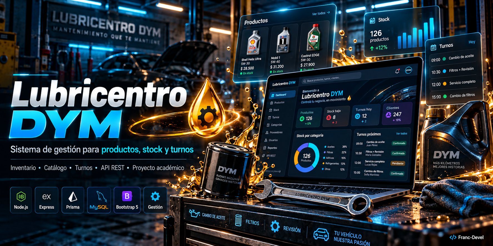

# 🛢️ Lubricentro DyM | Sistema de Gestión



> **Ilustración conceptual · No es una captura de una aplicación real.** Las cifras, métricas, pantallas y módulos del mockup son ficticios y no acreditan funcionalidades, resultados ni garantías. Proyecto académico. Productos, marcas, precios, stock, clientes, turnos y porcentajes se utilizan únicamente como elementos ficticios del mockup; no representan operaciones de un taller real.
>
> **Concept artwork · Not an actual application screenshot.** Figures, metrics, screens and modules are fictional; they do not substantiate implemented features, measured results or security guarantees. Refer to the documentation below for the project’s actual scope.

[Portada para Social Preview · 1280×640](assets/covers/cover-social.jpg) · Ilustración conceptual, no captura real.

Sistema integral para la administración de un lubricentro, desarrollado como proyecto académico para la cátedra **Metodología de Sistemas I**.

Permite gestionar productos, controlar el stock disponible y administrar reservas de turnos mediante una interfaz intuitiva y una API REST con Express y Prisma.

---

## 👨‍💻 Desarrolladores

* **Francisco Delgado**
* **Oriana Gordillo**

---

## 📋 Funcionalidades

### 🛒 Gestión de Productos

* Alta, baja y modificación de productos.
* Visualización completa del catálogo.
* Organización por categorías.

### 📦 Control de Stock

* Registro y actualización de existencias.
* Control de disponibilidad de productos.
* Gestión eficiente del inventario.

### 📅 Gestión de Turnos

* Reserva de turnos para servicios.
* Consulta de disponibilidad.
* Administración de reservas.

### 🧩 Tecnologías del backend

* API REST desarrollada con Express.
* Persistencia de datos mediante Prisma ORM.
* Base de datos MySQL.

---

## 🏗️ Arquitectura del Proyecto

El proyecto sigue una arquitectura **Monorepo**, separando claramente el backend y el frontend.

```text
Lubricentro-DYM/
│
├── Backend/
│   ├── prisma/
│   ├── src/routes/
│   ├── src/controllers/
│   ├── src/services/
│   └── index.js
│
├── Frontend/
│   ├── css/
│   ├── js/
│   ├── assets/
│   └── index.html
│
└── README.md
```

### Backend

Tecnologías utilizadas:

* Node.js
* Express.js
* Prisma ORM
* MySQL

### Frontend

Tecnologías utilizadas:

* HTML5
* CSS3
* JavaScript (Vanilla)
* Bootstrap 5

---

## 🚀 Instalación y Ejecución

**Ramas:** `main` presenta la documentación y la portada; el código está en [developer](https://github.com/Franc-Devel/Lubricentro-DYM/tree/developer). Las instrucciones siguientes corresponden a esa rama. No se afirma disponibilidad en producción ni una auditoría de seguridad.

### Requisitos Previos

Antes de comenzar, asegurate de tener instalado:

* Node.js
* XAMPP (MySQL)
* Git

---

### 1️⃣ Clonar el repositorio

```bash
git clone --branch developer https://github.com/Franc-Devel/Lubricentro-DYM.git
cd Lubricentro-DYM
```

---

### 2️⃣ Configurar la Base de Datos

Iniciar MySQL desde XAMPP y crear una base de datos vacía llamada:

```sql
sistema_lubricentro
```

Ingresar al directorio backend:

```bash
cd Backend
```

Configurar `DATABASE_URL` para tu base MySQL local, según [el esquema de Prisma](https://github.com/Franc-Devel/Lubricentro-DYM/blob/developer/Backend/prisma/schema.prisma). Usar credenciales de desarrollo y no publicarlas.

Instalar dependencias:

```bash
npm install
```

Sincronizar Prisma con la base de datos:

```bash
npx prisma db push
```

Cargar datos iniciales:

```bash
node prisma/seed.js
```

---

### 3️⃣ Iniciar el Backend

Desde la carpeta backend:

```bash
node index.js
```

Servidor disponible en:

```text
http://localhost:3000
```

---

### 4️⃣ Iniciar el Frontend

Abrir:

```text
/Frontend/index.html
```

o ejecutar mediante la extensión **Live Server** de Visual Studio Code.

---

## 🌿 Flujo de Trabajo Git

Para mantener una correcta organización del proyecto se utilizará una estrategia basada en Git Flow.

### Ramas principales

| Rama      | Descripción                                   |
| --------- | --------------------------------------------- |
| main      | Documentación y presentación pública          |
| developer | Rama de integración de nuevas funcionalidades |

### Ramas de funcionalidad

```text
feature/nombre-funcionalidad
```

Crear una nueva rama:

```bash
git checkout developer
git pull origin developer
git checkout -b feature/nombre-funcionalidad
```

Una vez finalizada la tarea:

```bash
git add .
git commit -m "feat: descripción de la funcionalidad"
git push origin feature/nombre-funcionalidad
```

Posteriormente se realizará la revisión correspondiente antes de integrarla a `developer`.

---

## 📚 Metodología de Desarrollo

Este proyecto se desarrolla aplicando conceptos de:

* Ingeniería de Software
* Scrum
* Git Flow
* Metodología de Sistemas I

---

## 📄 Licencia

Proyecto desarrollado con fines académicos para la carrera de Ingeniería en Sistemas.
